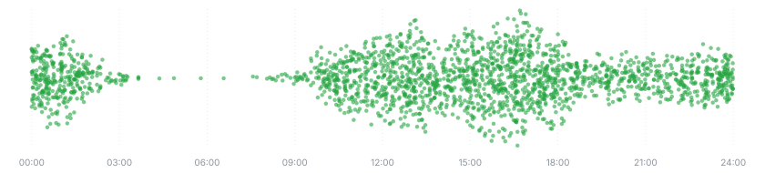

### Hang Zhengyang

I believe good systems come from people who understand them all the way down. Interfaces are useful, but the behaviour that matters is often decided a layer or two beneath them. I enjoy working at that level: asking why, measuring rather than guessing, and making trade-offs on purpose rather than by accident. It takes longer than taking things on faith, and I think it’s worth it.

**Projects and more at [dufanyin.dev](https://dufanyin.dev/)** · [LinkedIn](https://www.linkedin.com/in/hang-zhengyang/)
